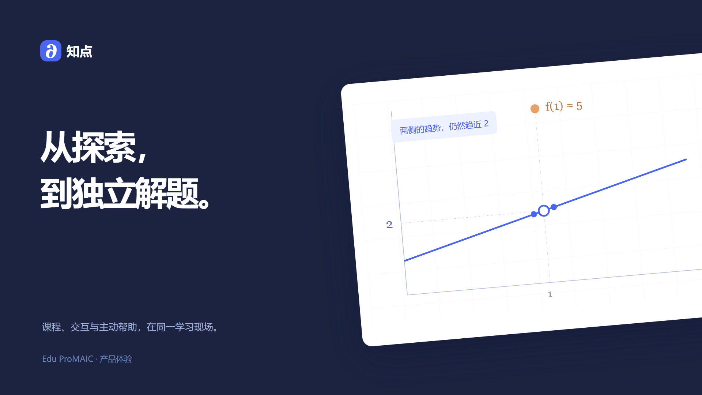

# Edu ProMAIC

[](https://github.com/LJHSTO/edu-promaic/actions/workflows/checks.yml)
[](https://nodejs.org/)
[](LICENSE)

知点（Edu ProMAIC）是一款主动学习工作台。学生在课程中阅读、操作和练习，按自己的偏好获得帮助，再通过一道新题检查理解。教师可以沿学习过程找到卡点，调整课程活动。

## 体验知点

[](docs/software/media/原型完整体验.mp4)

[观看体验视频](docs/software/media/原型完整体验.mp4) · [交互原型](docs/software/walkthrough/index.html) · [产品设计](docs/software/产品设计.md) · [技术架构](docs/software/architecture.md) · [技术入门](docs/software/技术入门.md)

从一节“函数值与极限”开始：设置帮助偏好，动手探索图形，查看课程出处，完成独立练习，最后进入教师工作台回看过程。下载仓库后，打开 `docs/software/walkthrough/index.html` 即可体验。

技术设计采用 React、NestJS、LangGraph 和 PostgreSQL + pgvector，通过学科包扩展更多课程。仓库同时提供轻量规则服务与自动化测试，便于逐步接入完整学习流程。

## 本地运行

需要 Node.js 22 或更新版本和随附的 npm。项目使用 Node.js 内置模块，没有需要安装的第三方依赖，也不需要模型密钥。

```powershell
git clone https://github.com/LJHSTO/edu-promaic.git
cd edu-promaic
npm start
```

在浏览器访问 [http://localhost:3000](http://localhost:3000)。页面与 API 由同一服务提供。停止服务时在终端按 `Ctrl+C`。

规则交互原型入口：[http://localhost:3000/prototype/](http://localhost:3000/prototype/)。包含学生学习工作台、教师示例记录筛选与回放、CSV 预览，以及等待和失败恢复。

端口被占用时，PowerShell 中可这样换端口：

```powershell
$env:PORT = '3001'
npm start
```

默认只监听本机。接入班级前需完成账户与权限模块，详见[技术架构](docs/software/architecture.md)。

## 试一遍学习流程

1. 在练习题中选择错误答案并提交。第一次错误只给出对错反馈，连续两次错误后出现自我解释提示。
2. 点击“再给一点线索”查看下一层提示，也可以收起提示或关闭本题主动提示。
3. 答对练习题后进入独立验证。此时提示区清空，求助按钮不可用。
4. 完成验证后查看本轮结果。“在提示后答对”和“验证题独立答对”分别记录。

学习状态保存在当前页面，刷新会重新开始。提示根据错误次数、冷却时间和提示预算触发。

## 检查与测试

```powershell
npm run check
npm test
```

`npm test` 运行全部单元和接口集成测试。也可用 `npm run test:unit`、`npm run test:integration` 分别运行。GitHub Actions 在推送和 Pull Request 时执行相同检查。

## 接口示例

`GET /api/health` 检查服务；`POST /api/decision/evaluate` 根据上下文返回决策。PowerShell 调用示例：

```powershell
$context = @{ consecutiveErrors = 2; misconceptionType = 'limit_equals_function_value' }
$body = $context | ConvertTo-Json
Invoke-RestMethod -Uri 'http://localhost:3000/api/decision/evaluate' -Method Post -ContentType 'application/json' -Body $body
```

响应示例：

```json
{
  "success": true,
  "data": {
    "action": "INTERVENE",
    "level": 1,
    "reasonCode": "REPEATED_ERRORS",
    "reason": "连续错误达到阈值，先从自我解释开始。"
  }
}
```

请求字段、默认值和错误响应见[接口说明](docs/software/接口说明.md)。演示接口不保存学习记录；调用方负责维护单题上下文。

## 仓库结构

```text
docs/
  requirements/   问题定义、功能与非功能规格、用户故事
  algorithm/      规则策略、参数与选型依据
  software/       架构、接口和原型说明
  mgmt/           团队协作、迭代计划、风险与议题落实记录
  retrospection/  阶段复盘
code/
  backend/        HTTP 服务和静态页面入口
  frontend/       学生练习演示
  core_engine/    不依赖网络或存储的决策逻辑
tests/
  unit/           决策规则测试
  integration/    HTTP 接口测试
.github/          自动检查、Issue 和 PR 模板
data/             预留课程包、知识图谱与脱敏测试素材
```

## 文档与协作

开发资料：[用户故事](docs/requirements/user_stories.md) · [交互原型](docs/software/prototype/README.md) · [技术架构](docs/software/architecture.md) · [开发计划](docs/mgmt/week3_learning_plan.md) · [迭代记录](docs/mgmt/week3_delivery.md)。

- [问题定义与产品描述](docs/requirements/problem_definition.md)
- [功能规格](docs/requirements/functional_spec.md) · [非功能规格](docs/requirements/nonfunctional_spec.md) · [用户故事](docs/requirements/user_stories.md)
- [算法说明](docs/algorithm/research.md) · [系统架构](docs/software/architecture.md) · [原型说明](docs/software/prototype/README.md) · [课程设计](docs/software/课程设计.md)
- [沟通管理](docs/mgmt/communication_mgmt_plan.md) · [迭代计划](docs/mgmt/迭代计划.md) · [风险管理](docs/mgmt/risk_mgmt_plan.md)
- [任务记录](docs/mgmt/议题落实记录.md) · [复盘记录](docs/retrospection/README.md)
- [GitHub 协作流程](docs/mgmt/协作流程.md)

问题与建议统一提交到 [GitHub Issues](https://github.com/LJHSTO/edu-promaic/issues)。贡献流程见 [CONTRIBUTING.md](CONTRIBUTING.md)。本项目采用 [MIT 许可证](LICENSE)。
