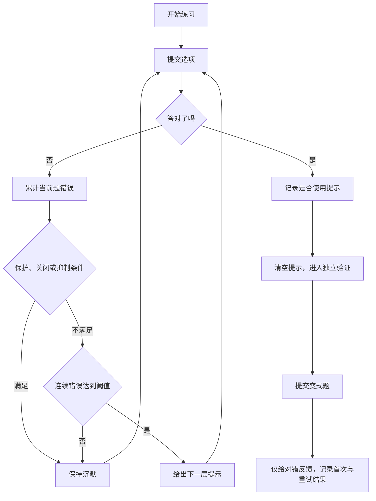
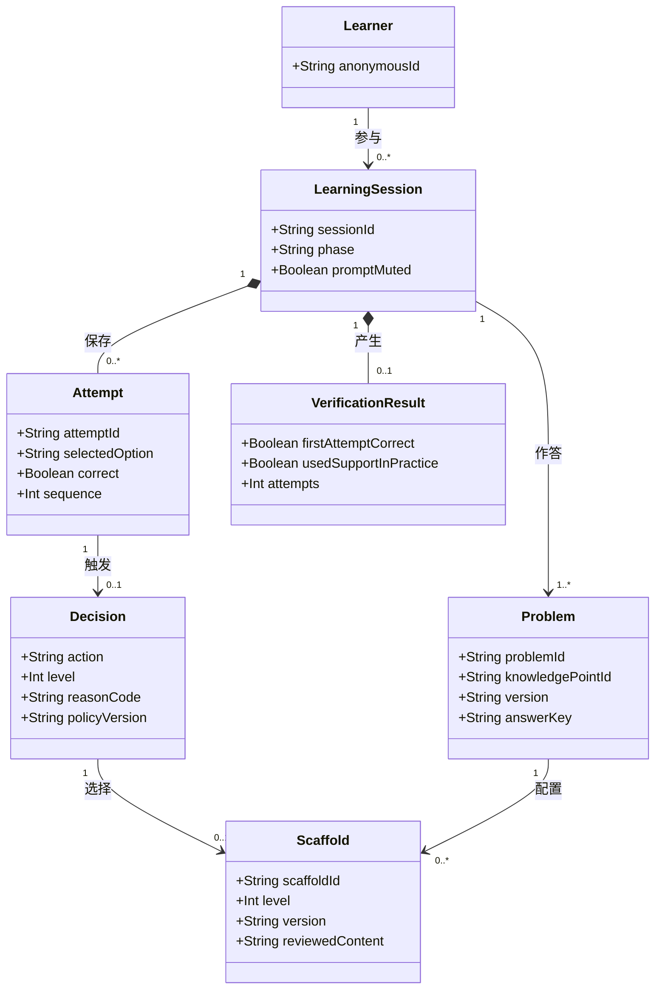

# 功能需求规格说明书

| 项目 | 内容 |
|---|---|
| 系统 | Edu ProMAIC |
| 版本与日期 | 0.2，2026-10-13 |
| 对应议题 | [#6](https://github.com/LJHSTO/edu-promaic/issues/6) |
| 适用范围 | 学生练习、分级提示、独立验证，以及后续教师分析 |
| 编号 | FR-x.y：功能；US-x：用户故事；AC-x：验收；NFR-x：质量目标 |
| 文档状态 | 待教师评审的需求基线；实现状态单独标注 |

本文采用课程要求的“角色—功能树—领域模型—验收”结构，参考[课程规范书要求](https://github.com/bettermorn/IntelligentSWEPractice/blob/main/courseware/pages/part1analyze.md#第-2-周实践软件功能规范书撰写)及[功能规格示例](https://github.com/bettermorn/AIAgent/blob/main/docs/AIAgentFunSpec.md)。参考模板用于组织条目，不代表本项目已通过标准符合性认证。

## 1. 术语与边界

“主动提示”由系统根据作答行为发起；“主动求助”由学生点击按钮发起，二者分别计数。“受保护验证”是不给提示的变式题阶段。“连续错误”只统计当前题目的连续错误提交，不跨题累计。提示后原题正确称为“辅助完成”，无提示验证正确称为“本次验证通过”，两者均不能单独证明长期掌握。

首个演示仅含极限选择题。函数、导数、积分课程包和教师端属于后续范围。正式考试、学校教务和感官采集不在本项目范围内。

## 2. 系统角色

| 参与者 | 操作及责任 | 当前支持 |
|---|---|---|
| 学生 | 作答、求助、关闭或收起提示、完成独立验证 | 单页面演示 |
| 教师、助教 | 审核题目与提示、查看误解汇总、回放一次帮助过程 | 需求已定义，界面未实现 |
| 项目维护者 | 管理题库版本、配置策略、运行测试和发布 | 仓库维护；没有在线管理端 |
| 可选模型服务 | 根据已审核材料提出提示草稿 | 未接入；不得控制保护状态 |

决策引擎、提示模板与存储是系统内部模块，不作为用户角色。当前没有登录、身份认证和真实班级权限；上线前须满足 NFR-5。

## 3. 功能树

```text
Edu ProMAIC
├── FR-1 学习行为：作答事件、特征提取、断网补传
├── FR-2 时机决策：连续错误、沉默保护、冷却与预算
├── FR-3 分级提示：模板选择、学生控制、内容审核
├── FR-4 独立验证：变式题、阶段保护、结果区分
├── FR-5 学习工作区：题目展示、反馈、个人记录
└── FR-6 教师分析：汇总、回放、匿名导出
```

下表中的“后续”表示已提出需求，尚未实现；验收条件是实现后的完成判据。

### 3.1 学习行为

| 编号 | 输入、处理与输出 | 优先级 / 状态 | 验收条件 |
|---|---|---|---|
| FR-1.1 | 接收题目编号、选择项、提交时间；题目规则判断对错，提取连续错误和误解标记 | 必须 / 演示已实现 | 错误提交累加；正确或切题后清零；每个错误选项均有反馈 |
| FR-1.2 | 接收停顿秒数和有效输入标志；长停顿仅作背景证据，不独立触发帮助 | 必须 / API 支持；页面无草稿采集 | 无连续错误，即使停顿超过 45 秒也保持沉默；有效输入时抑制主动提示 |
| FR-1.3 | 后续接收带事件 ID、匿名会话 ID、题目 ID 和客户端时间的事件；断网排队，恢复后按序补传并去重 | 应当 / 后续 | 同一事件重传三次只保存一份；乱序事件按序号回放；失败明确显示，不丢弃未确认事件 |

### 3.2 时机决策

| 编号 | 输入、处理与输出 | 优先级 / 状态 | 验收条件 |
|---|---|---|---|
| FR-2.1 | 当前题连续错误达到 2 次，且无抑制条件，返回 `INTERVENE`、L1 和规则原因；后续提示逐层增加 | 必须 / 已实现 | 首次错误不自动提示；第 2 次首次介入为 L1，不跳到 L2；错误选项未匹配误解也可给通用自我解释 |
| FR-2.2 | 独立验证优先返回 `SILENCE`；关闭提示同样抑制；有效输入抑制自动提示 | 必须 / 已实现 | 即使同时出现大量错误或主动求助，保护阶段仍为 L0；关闭提示后为 L0 |
| FR-2.3 | 默认两次主动提示间隔至少 60 秒；页面维护距上次提示时间 | 必须 / 已实现 | 59 秒时抑制；60 秒时可继续评估；收起提示后不立即自动重新展开 |
| FR-2.4 | 每题最多 2 次主动提示；主动求助不消耗主动预算，但不能绕过受保护状态 | 必须 / 已实现 | 预算为 2 时仍有错误也保持沉默；主动求助按 FR-3.1 逐级返回提示 |
| FR-2.5 | 输入不合法时拒绝评估，返回字段错误，不隐式把字符串转换为布尔值或数字 | 必须 / 已实现 | 负数、非整数错误次数、`"false"` 等无效值返回 400；规则输出可用 `reasonCode` 区分 |

### 3.3 分级提示与学生控制

| 等级 | 内容边界 | 演示中的用途 |
|---|---|---|
| L0 | 不提供提示 | 等待、关闭、冷却、预算用尽和保护阶段 |
| L1 | 请学生解释判断依据 | 区分“趋近于一个点”与“取到这个点” |
| L2 | 一个概念线索 | 比较邻近点的变化与单点定义 |
| L3 | 拆出子目标 | 分别考察点值和附近表达式 |
| L4 | 只推动局部一步 | 提醒查看分子能否因式分解 |
| L5 | 换数值的部分示例 | 用另一个差平方表达式演示结构，不给原题答案 |

| 编号 | 输入、处理与输出 | 优先级 / 状态 | 验收条件 |
|---|---|---|---|
| FR-3.1 | 根据当前等级返回下一层提示，最高 L5；模板按题目选择 | 必须 / 单题模板已实现 | 自动首次为 L1；主动求助逐级推进，最高 L5；页面按返回等级显示不同内容 |
| FR-3.2 | 学生可收起提示、关闭本题主动提示、恢复提示或主动求助；提示不以模态弹窗呈现 | 必须 / 已实现 | 收起后答题仍可操作；关闭后不自动出现新提示；保护阶段清空提示并禁用求助 |
| FR-3.3 | 发布前由教师检查提示是否包含原题结果或完整解法；模型草稿不得直接发送 | 必须 / 固定模板；人工评审待进行 | 对每题每级提示逐条签审；发现越界内容阻止发布，转回审核模板 |
| FR-3.4 | 后续支持“换一种表达”，在同一级切换已审核表征 | 可选 / 后续 | 不因换表达提高等级，不改变原题和验证状态 |

### 3.4 独立验证

| 编号 | 输入、处理与输出 | 优先级 / 状态 | 验收条件 |
|---|---|---|---|
| FR-4.1 | 原题答对后提供同概念、不同数值的验证题，记录原题是否看过提示 | 必须 / 已实现 | 辅助完成后能进入变式题；未使用提示的学生也可验证，结果保留独立标签 |
| FR-4.2 | 进入验证时清空旧提示、重置题目计数并设置保护标志；禁止主动与被动求助 | 必须 / 演示已实现 | 验证错答不会出现提示；API 对保护请求始终返回 L0；后续由服务端保存阶段，不能仅信任客户端 |
| FR-4.3 | 区分首次验证通过、重试后完成与尚未通过；验证失败不输出概念支架 | 必须 / 已实现 | 首次错误后再答对显示“重试后完成”；不把它归入首次独立通过 |
| FR-4.4 | 后续通过新题型和延迟复习观察迁移与保持，独立证据增加后降低提示频率 | 应当 / 后续 | 辅助完成记录不直接提高长期掌握标签；渐退规则须有单独测试与教师评审 |

### 3.5 学习工作区

| 编号 | 输入、处理与输出 | 优先级 / 状态 | 验收条件 |
|---|---|---|---|
| FR-5.1 | 展示题干、数学表达式、选项和当前阶段 | 必须 / 已实现 | 公式可读；键盘能选择与提交；窄屏无横向溢出 |
| FR-5.2 | 无选项、网络失败或返回异常时给出中文反馈；保留选择和错误次数 | 必须 / 已实现 | 失败不假装已获得提示；重试不会把同一次提交累计两次 |
| FR-5.3 | 展示本轮练习和验证结果；后续提供跨会话学习记录 | 应当 / 本轮已实现；历史记录后续 | 辅助完成、首次验证、重试完成分别呈现；不使用未经证实的“已掌握”标签 |

### 3.6 教师分析

| 编号 | 输入、处理与输出 | 优先级 / 状态 | 验收条件 |
|---|---|---|---|
| FR-6.1 | 按知识点汇总错误、提示、首次验证结果及样本量 | 应当 / 后续 | 显示分子、分母和缺失数量；小样本不下班级结论 |
| FR-6.2 | 按匿名会话回放事件、决策原因、提示版本和学生响应 | 应当 / 后续 | 输入同一上下文和规则版本可重算同一决策；沉默也有记录 |
| FR-6.3 | 授权教师导出所授班级的匿名 CSV / JSON，记录导出操作 | 应当 / 后续 | 导出不含姓名、学号、草稿原文或密钥；跨班级请求被拒绝 |

## 4. 正常与异常流程



网络异常时保留当前选择，提供重试。后续存储失败时不能返回“已保存”；验证题缺失时显示“暂时没有验证题”，不把原题结果当成独立验证。当前演示不支持刷新恢复，这一点在 README 明示。

## 5. 领域模型

下图描述目标系统的学习数据对象。决策引擎是执行这些规则的服务，不是学习对象。当前页面仅在内存中维护这些对象的部分字段，持久化与课程包尚未实现。



标答只供判分和内容审查。当前演示的浏览器源码中有固定判分值，不能用作正式测验；后续标答须由服务端保管。

## 6. 验收与追踪

| 验收编号 | 关键场景 | 需求 | 对应验证 |
|---|---|---|---|
| AC-01 | 两次错误后首次提示为 L1，各错误选项均可重试 | FR-1.1、FR-2.1、FR-3.1 | 决策单元测试、浏览器走查 |
| AC-02 | 停顿、有效输入、冷却和预算分别触发预期沉默 | FR-1.2、FR-2.2–2.4 | 决策边界与组合测试 |
| AC-03 | 关闭、恢复、收起及主动求助 | FR-3.1–3.2 | 单元测试、键盘操作走查 |
| AC-04 | 提示后答对进入验证；清空旧提示；验证不求助 | FR-4.1–4.2 | 保护规则测试、浏览器完整流程 |
| AC-05 | 验证首次失败再成功，显示重试结果 | FR-4.3、FR-5.3 | 浏览器走查 |
| AC-06 | 无效请求被拒绝，网络失败可重试 | FR-2.5、FR-5.2 | API 集成测试、网络异常走查 |
| AC-07 | 教师可汇总、回放、匿名导出且权限正确 | FR-6.1–6.3 | 后续里程碑验收，当前未通过 |

用户故事见[user_stories.md](user_stories.md)。响应时间、恢复、隐私和可维护性要求见[非功能规格](nonfunctional_spec.md)，接口字段见[接口说明](../software/接口说明.md)。