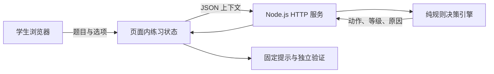
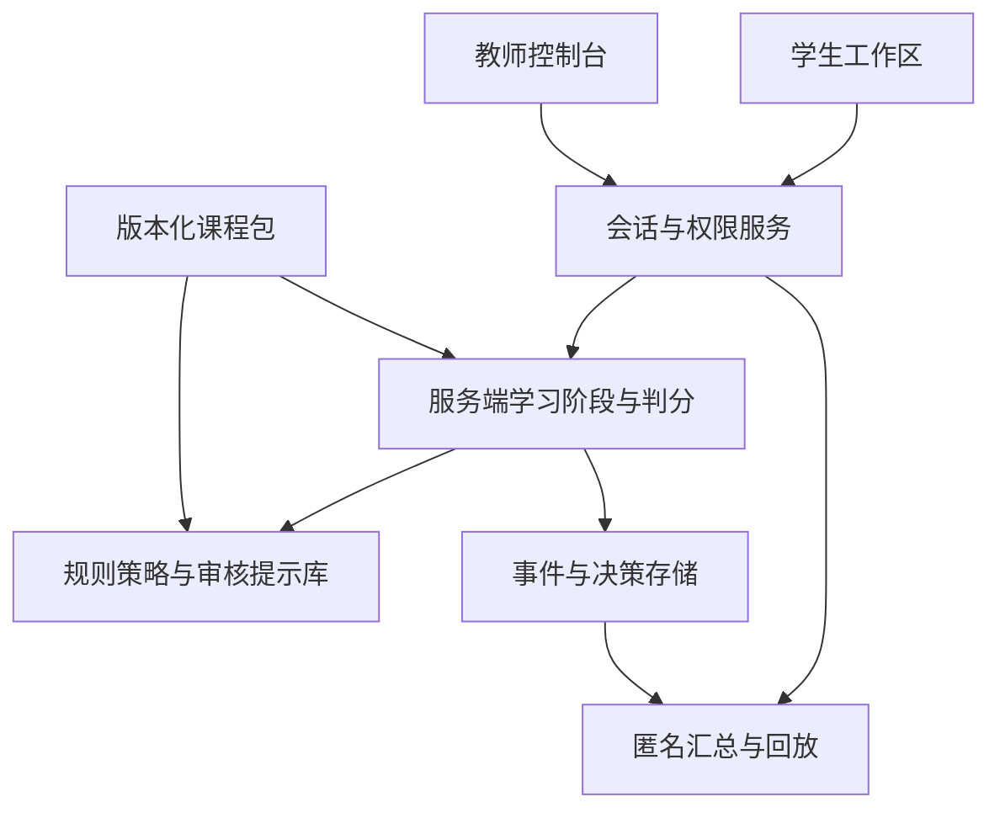

# 系统架构

修订日期：2026-10-13。当前实现是一个无第三方运行依赖的本机演示。

## 1. 当前结构

| 模块 | 当前职责 | 明确边界 |
|---|---|---|
| code/frontend | 数学题显示、提交、固定提示、开关与结果；维护单题状态 | 状态只在内存；没有登录或持久化 |
| code/backend | 提供页面和 API，限制请求大小，校验媒体类型，转换错误响应 | 使用 Node.js 内置 HTTP；未接数据库和模型 |
| code/core_engine | 校验上下文并决定介入或沉默，给出规则原因 | 无网络、存储、计时器或浏览器依赖 |
| tests | 规则边界及真实 HTTP 请求测试 | 浏览器走查结果另记，不用 API 测试代替交互测试 |

公式使用浏览器原生 MathML，固定提示不依赖外部 CDN。后续复杂课程表达式再评估 KaTeX；当前不能宣称已经接入 KaTeX。

## 2. 一次提交

前端读取选项，计算待提交的错误次数；决策请求成功且格式正确后才更新计数。请求失败时保留选择与旧计数。服务端根据上下文返回动作，不保存记录。进入独立验证时前端清空旧提示并设置保护标志，核心引擎优先执行保护规则。

前端与 API 同源，避免直接打开 HTML 时产生 file 协议请求。静态资源使用固定路由表，不按用户输入任意读取路径。默认只监听 127.0.0.1。

当前浏览器源码包含固定题目的判分值，保护状态由页面提供，因此只能演示流程。正式测验需将判分、验证状态和预算转到服务端。

## 3. 下一阶段

课程包需要知识点、学习目标、误解标注、提示等级、验证题、表征和结果指标。事件包括匿名会话、题目、顺序、时间、规则与提示版本；不采集原始按键和身份文本。

后续存储选择在实现前单独评审，SQLite 是候选，并非已采用。普通日志只提供追踪，不称为不可篡改。教师回放、匿名导出和跨会话历史记录均未实现；验收见 FR-6 和 NFR-4–7。

## 4. 测试与运行

`npm start` 提供页面和 API，`npm run check` 检查语法，`npm test` 同时执行单元和接口测试。接口字段见[接口说明](接口说明.md)，交互见[原型说明](prototype/README.md)。