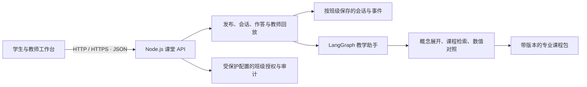
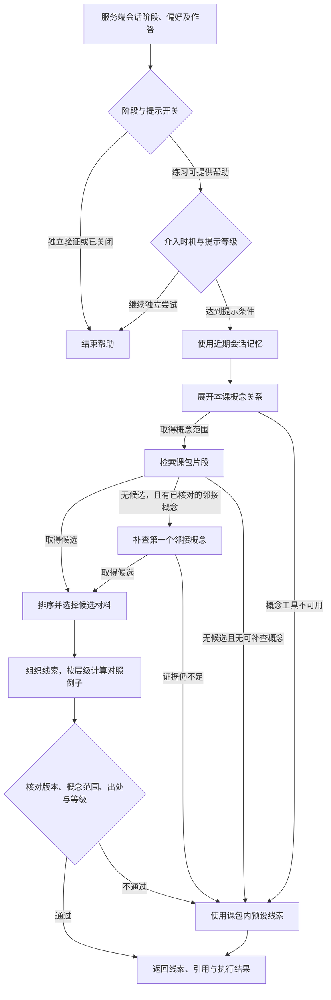

# Edu ProMAIC 技术架构

版本 1.2 · 2026-11-25

知点服务大一微积分翻转课堂。教师布置“函数值与极限”课前任务，学生阅读、练习并完成独立验证。教师根据首次验证结果、练习提示和误选记录安排课堂讨论。

## 1. 运行架构

| 模块 | 当前实现 |
|---|---|
| 学生与教师工作台 | HTML、CSS 和原生 JavaScript。学生查看作答反馈、课程出处和提示依据。教师发布任务、查看汇总和事件时间线。 |
| 服务端会话 | Node.js HTTP 服务维护课程发布状态、会话版本、作答和判分。浏览器通过带版本的事件提交操作。 |
| 教学助手 | LangGraph JS 执行提示流程，根据阶段、偏好和作答触发分级线索。 |
| 课程知识 | 课包校验版本、概念、图谱关系、来源与提示分级。检索读取已发布的课程片段。题目和答案使用独立结构。 |
| 存储与访问 | 单进程写入课堂记录。机构部署按班级隔离，使用加密存储、机构身份令牌及独立审计角色。 |

[接口契约](接口说明.md) · [运行步骤](../../README.md) · [部署与安全](security.md)

## 2. 教学助手怎样处理一次作答

课前练习把点上的函数值设为 1，要求学生判断自变量靠近该点时的极限。第一次误选 1 时，系统给出对错反馈。连续第二次误选时，规则触发 L1 自我解释线索。近期两次误选进入当前会话的记忆投影，并让检索词聚焦“点值”和“附近趋势”。线索引用本课版本的“直观地定义函数的极限”片段。学生继续求助至 L4 时，可查看工具计算的另一组数值，比较规定的单点值与两侧的附近数值。

1. 服务端确认当前会话和阶段。练习允许主动求助，自动提示受连续错答、冷却时间及次数约束。进入独立验证后，接口仅接受作答，页面清除练习提示。
2. 规则决定是否继续和允许的提示等级。教学助手从已完成的练习事件读取近期误选和已引用来源，将记忆用于检索聚焦与候选排序。
3. 概念工具展开“函数值与极限”的一跳关系，包括左右极限、邻域内等价表达式和一点处的连续性。编排将当前概念和核对过的邻接概念传给检索。检索在该范围内按课程版本、提示等级和关键词选出片段。首轮无候选时，取第一个已核对的邻接概念补查一次。
4. 提示优先采用近期未引用的候选片段。片段须属于本次检索的概念范围，通过检查后才可交给模型选材。提示正文由服务端根据课包和教学步骤组合，较深等级可调用数值工具计算独立例子。输出前从课包重读并核对内容、版本、范围与级别。证据或引用校验失败时，返回课包预设线索。
5. 响应提交前再次检查会话版本。重复请求按事件编号去重，已过期的异步结果返回冲突。通过校验的结果连同事件写入会话，等待下一次学生操作。

学生可从“线索依据”查看课程来源、参考了哪些作答信号和执行步骤。教师回放显示作答、提示级别、执行结果及工具名称。

课包分别记录发布状态与教学审核状态。检索、图谱和引用读取都检查课包发布状态，草稿片段不进入候选。当前课程作为演示内容发布，教学审核状态为待确认。 [课包校验](../../code/core_engine/learning_agent/course-pack-schema.js)

[编排实现](../../code/core_engine/learning_agent/agent.js) · [课堂会话](../../code/backend/classroom.js)

### 模型选材

同时配置 `DEEPSEEK_API_KEY` 与 `DEEPSEEK_MODEL` 后，至少有两个近期未引用且通过校验的候选时，编排可以调用 DeepSeek。请求只包含提示等级和候选片段的编号及课程正文。模型返回一个 JSON 片段编号，服务端核对它是否属于本次候选集合。请求限时 2.2 秒，超时、格式错误或选到候选之外的编号时按检索顺序选材。课程答案、学生身份、会话历史和判分由知点服务端管理。 [模型适配器](../../code/backend/model-planner.js) · [DeepSeek JSON 输出规范](https://api-docs.deepseek.com/guides/json_mode/)

## 3. 工具、知识图谱与记忆

| 工具 | 输入范围 | 输出 |
|---|---|---|
| `expand_course_concept` | 已发布课包版本、当前概念 ID | 有类型的相邻概念和关系 |
| `retrieve_course_passages` | 版本、当前概念、核对后的邻接概念编号、限定长度查询、提示等级、返回条数 | 带片段编号、来源链接、章节和版本的课程材料 |
| `compare_point_neighborhood` | 限定范围内的示例点值 | 独立于当前试题的附近数值和对照问题 |

工具使用固定名称和参数校验。数值表由程序计算，比较点值与附近趋势时无需读取试题答案。练习和验证答案由服务端判分模块维护，学生检索范围由课程片段构成。

- **课程知识图谱**表示概念之间的关系，限定相关材料的检索范围。当前课程的概念、关系和片段收录在同一课包版本。
- **课程检索**为当次提示提供可核对的教材依据。关键词匹配结合概念关系和提示等级，候选材料带稳定编号、章节和版本。
- **学习记忆**可由本会话的事件重建，读取最近 16 条事件、统计其中的练习误选，并保留至多 6 个最近引用的来源编号。下一轮优先使用近期未引用的材料。独立验证表现单独记录。

[课程课包](../../code/core_engine/learning_agent/knowledge-data.js) · [检索实现](../../code/core_engine/learning_agent/knowledge.js) · [工具参数](../../code/core_engine/learning_agent/tools.js) · [记忆投影](../../code/core_engine/learning_agent/memory.js)

## 4. 会话与运行配置

课堂会话从练习进入独立验证，再进入完成状态。每个接受的作答或提示操作递增会话版本。创建会话时提供幂等键可以重试同一次创建。事件响应中断后，客户端以相同事件编号和版本重传；服务端返回同一会话的最新状态。课包、历史事件、记忆与提示分别有明确的读写边界，会话事件是恢复与回放的依据。

| 配置 | 使用场景 | 访问与持久化 |
|---|---|---|
| 演示 | 一台电脑操作课堂流程 | 回环连接和匿名会话，课堂状态保存于单个本地文件 |
| 受保护 | 班级部署与验收 | HTTPS，校验机构签发的访问令牌，通过服务端名册授权学生、教师和审计员。按班级加密存储，审计记录使用独立密钥校验完整性。 |

学生读取和提交自己的会话，教师查看所管班级并导出预习结果，审计员读取本班的访问记录。运营侧可导出全量审计快照并与独立检查点比对，校验备份清单后将课堂密文恢复到新目录。机构账号体系、网络边界、持久留存和恢复目标随部署环境一起验收。 [运行与验收](security.md)

[安全控制与等级保护对照](security.md)

## 5. 扩展设计

- **课程规模。** 按定义、条件、例题和补充讲解切片，沿用概念 ID、来源和用途字段。教师确认内容后发布课程版本，活动、题目和知识片段随版本一起生效。
- **数据库与检索。** 计划使用 PostgreSQL 保存课程版本、班级、会话、事件和提示记录，在一笔事务内递增版本并持久化事件。pgvector 承载课程向量，BGE-M3 可作为编码方案。先按课程版本、用途及权限过滤，再融合向量与关键词结果。比较标注查询的召回率、引用准确率和延迟后确定排序策略。
- **工作台与服务。** 用活动适配契约接入更多课件。迁移 React 工作台或 NestJS 服务时沿用当前请求、会话和课程工具边界，保持角色与验证规则一致。
- **可靠性与课堂验收。** 当前以单节点请求与会话持久化恢复。接入更慢的任务后，按会话和帮助轮次保存编排检查点，并为并发、恢复及延迟补充验收样本。

[代码质量报告](code_quality.md) · [代码评审记录](code_review.md) · [会话任务 #8](https://github.com/LJHSTO/edu-promaic/issues/8) · [课程与授权任务 #9](https://github.com/LJHSTO/edu-promaic/issues/9)
