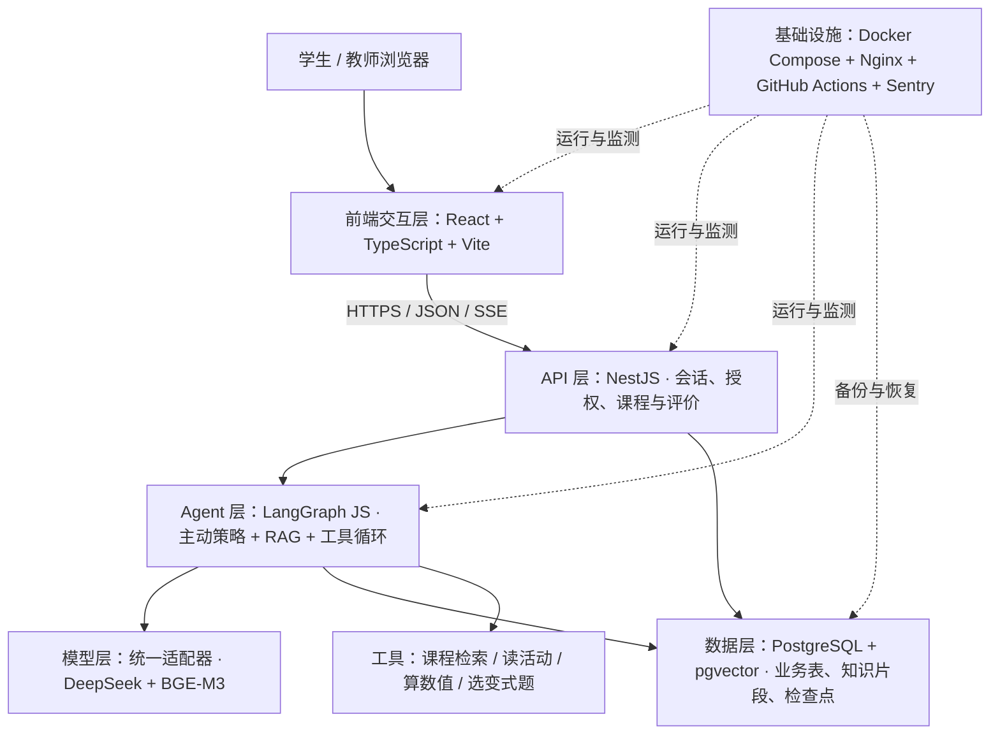
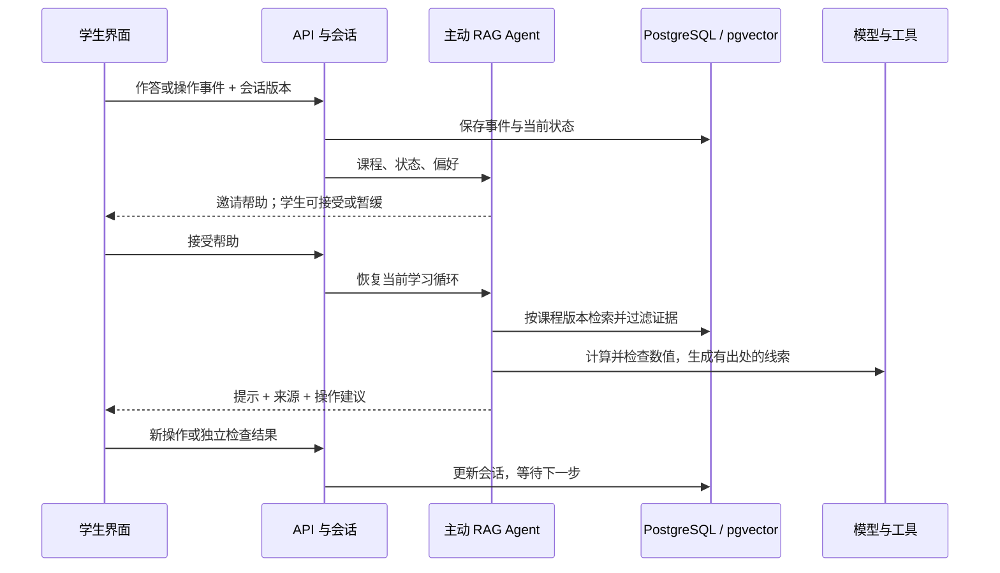
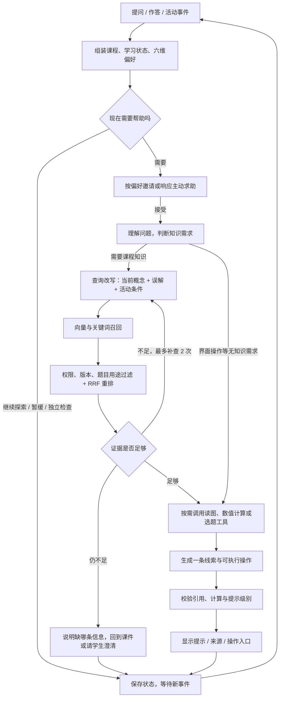

# Edu ProMAIC 技术架构

版本 1.1 · 2026-11-04

Edu ProMAIC 把课程讲解、交互探索、主动帮助和独立检查放进同一学习工作台。当前用“函数值与极限”说明产品，后续通过学科包扩展物理、编程和语言学习。学生可以决定帮助出现的时机、位置、起点及继续方式；教师根据过程记录改进课程。

[产品设计](产品设计.md) · [体验视频](media/原型完整体验.mp4) · [交互原型](walkthrough/index.html) · [技术入门](技术入门.md)

本方案采用 React、NestJS、LangGraph JS 和 PostgreSQL + pgvector，按工作台、学习服务、课程知识与学科包逐步实施。仓库提供交互原型和规则服务作为开发起点。

## 1. 产品目标与功能

| 优先级 | 功能 | 用户得到什么 |
|---|---|---|
| P0 | 课程与活动工作台 | 讲解、图形、题目在同一任务上下文中切换 |
| P0 | 学生可调节的主动帮助 | 从判断依据、介入时机、支持起点、显示位置、控制方式、帮助后继续方式六方面选择 |
| P0 | 课程 RAG 与工具支持 | 提示带课程出处，可跳回原段落，数值由工具计算 |
| P0 | 独立检查与学习回顾 | 区分帮助后完成和新题独立完成，回看下一步学习安排 |
| P1 | 教师课程与过程工作台 | 看学习过程、调整活动、审核并发布课程版本 |
| P1 | 学科包 | 替换知识、活动、题目和工具，复用通用学习流程 |

首个版本聚焦教师整理的课程内容；正式考试的成绩裁定由教师负责。课堂内容生成和课程发布在教师确认后生效。

质量目标：帮助请求首次状态反馈 ≤1 秒；课程检索 P95≤1 秒，首条有用提示 P95≤8 秒；30 名学生并发练习；所有课程引用能定位版本与段落；独立检查期间不显示解题提示。验证方法见第 10 节。

## 2. 开发与运行环境

目标使用 TypeScript 5、Node.js 24 LTS；前端 React 19 + Vite，API NestJS 11，Agent 使用 LangGraph JS 1.x。数据为 PostgreSQL 17 + pgvector 0.8.x。目标版本在实施时固定到补丁号、npm lockfile、容器摘要与模型版本，现有 package.json 继续描述可运行规则演示。

开发工具：VS Code、Git、GitHub、浏览器开发工具、OpenAPI/Swagger；AI 辅助生成后执行代码审查与测试。Windows 或 Linux 开发，Linux 部署；课程演示服务器以 4 vCPU / 8 GB 内存为起步预算，向量编码服务独立部署或按需调用，硬件需求由压测确认。

外部服务只包括模型 API 和代码托管。`DATABASE_URL`、`LLM_API_KEY`、`EMBEDDING_BASE_URL` 通过服务端环境或部署密钥注入；浏览器只接收当前用户的会话数据。开发配置在不入库的 `.env` 中，仓库仅存字段说明。

## 3. 总体架构：六层怎样连起来

| 层 | 选型与理由 | 输入 → 输出 | 依赖 |
|---|---|---|---|
| 前端交互层 | React + TypeScript + Vite；拆分可复用课件、帮助和教师组件，类型约束活动事件 | 点击、作答、图形状态 → 请求与界面反馈 | API；KaTeX、SVG/Canvas、Three.js |
| API 层 | NestJS；课程、会话、评价按模块组织，统一参数校验与授权 | 身份、课程、事件 → 会话状态、Agent 流、结果 | Agent、PostgreSQL |
| Agent 层 | LangGraph JS；显式节点、条件分支、检查点与暂停恢复适合学习过程 | 学习上下文、偏好 → 带出处的下一步行动 | 模型适配器、检索和专业工具 |
| 模型层 | DeepSeek API 生成解释，BGE-M3 编码知识与查询；统一接口便于替换 | 任务与证据 → 结构化提示；文本 → 1024 维向量 | 托管生成 API、独立编码服务 |
| 数据层 | PostgreSQL + pgvector；关系事务、JSONB 活动状态、向量检索在一个数据库管理 | 事件、来源、向量 → 会话恢复、课程证据、教师汇总 | 持久卷与备份 |
| 基础设施层 | Docker Compose + Nginx；适合课程规模，部署路径短；Actions + Sentry 做检查与错误定位 | 镜像、配置、运行事件 → HTTPS 服务、构建结果与告警 | Linux 主机、数据库备份目录 |

采用模块化单体：API 和 Agent 在同一 Node.js 应用中，向量编码作为独立服务。暂不需要 Kubernetes、独立向量数据库或多 Agent 团队。

架构决策：React 保留现有课件，通过活动适配器逐步接入；NestJS 复用现有纯规则模块；PostgreSQL 直接作为目标存储；LangGraph 把检索和等待学生这两类循环明确建模。代价分别是组件迁移、服务模块整理、数据库运维和状态图学习成本。

展开六层详细设计、数据模型与测试方案

## 4. 前端：把现有课件接进 React 工作台

页面划分为课程首页、学生工作台、学习回顾和教师工作台。公共组件为 `CourseShell`、`ActivityViewport`、`PreferencePanel`、`AssistantPanel`、`CitationDrawer`、`IndependentCheck` 和 `SessionTimeline`。

本地开关和折叠使用 React 状态；课程、会话等服务器状态用 TanStack Query；用 React Router 管理页面。统一 CSS 变量定义蓝色主色、语义色、字号、间距与焦点。公式用 KaTeX；二维课件沿用 SVG/Canvas，三维活动保留 Three.js。

已有 HTML 课件先放在 iframe 活动容器，由固定的 `postMessage` 契约传递 `activityId / revision / event / state`，校验 origin 和来源窗口。后续把常用图形控件迁为 React 组件，无需一次重写所有课程。

请求用 fetch + JSON，帮助输出用 SSE 事件 `status / hint / citation / done / error`。浏览器显示“查找本节材料”“整理线索”等任务状态，不展示模型内部思维。失联保留作答与图形，提供重试；取消会终止本次请求。

原型三层对应：界面层稳定保留课程导航、活动和助手；视觉层用统一组件与变量；体验层明确加载、成功、暂缓、失败和恢复。按钮支持键盘，引用可展开，移动端导航折叠，结果使用文字和图标共同表达。

实施顺序：工作台壳与路由 → 活动适配器 → 偏好和帮助组件 → 学习回顾 → 教师课程管理。每步先复用当前规则 API，再连接目标服务。

## 5. API：课程、会话与学习事件

NestJS 模块分为 Auth、Course、Session、Assistant、Assessment 和 Teacher。由 DTO 校验输入，Guard 校验角色及课程权限，Service 执行业务，Repository 访问数据库。REST 契约用 OpenAPI 描述。

| 目标接口 | 输入 | 输出 |
|---|---|---|
| POST /api/sessions | courseVersion、activityId | sessionId、phase、revision |
| POST /api/sessions/:id/events | eventId、revision、操作或作答 | 新 revision、活动状态 |
| PATCH /api/sessions/:id/preferences | 六维偏好及版本 | 保存后的偏好 |
| POST /api/assistant/runs | sessionId、query、接受帮助动作 | runId |
| GET /api/assistant/runs/:id/events | 已授权 runId | SSE 状态、提示、引用与结束 |
| POST /api/sessions/:id/check | itemId、answer、eventId | 结果、下一活动 |
| GET /api/teacher/courses/:id/sessions | 班级与筛选 | 已授权过程汇总 |

事件结构包含 `eventId, sessionId, activityId, type, payload, revision`。服务端拥有阶段和标准答案；客户端上报当前操作。重复 eventId 返回原结果，旧 revision 返回 409 并重新拉取状态。400 提示输入问题；403 说明无访问权限；429 提示稍后重试；503 保留当前进度并提供审核过的基础线索。

## 6. Agent：在 RAG 基础上接住学习过程

### 6.1 从老师的 RAG 模式扩展

基础 RAG 负责理解问题、检索、重排、补查、生成和引用校验。Edu ProMAIC 在入口加“学习状态与偏好”，在出口加“可执行的学习行动与学生反馈”。这样引用材料服务于当前活动，回答之后还有下一步。

**内层检索与工具循环**完成本次帮助：召回不够才补查，工具结果再送回生成节点。**外层学习循环**在学生回答、拖动或完成新题后继续；等待时保存检查点并结束本次执行，不空转调用模型。

### 6.2 模块、工具与记忆

LangGraph 节点包括 `context → policy → retrieve → rerank → act → verify → respond → wait`。状态保存 `sessionId、courseVersion、phase、preferences、activityState、evidenceIds、lastAction、runId`。短期记忆保留当前任务与最近对话摘要；长期存学习事件、偏好和回顾结果。课程知识放在独立知识库，不把聊天历史当教材。

| 工具 | 输入 | 输出与用途 |
|---|---|---|
| search_course | 课程版本、概念、查询 | 带页码、片段 ID 的材料；支持引用 |
| read_activity | 当前会话与活动 | 图形参数与最近有效操作 |
| evaluate_values | 已登记函数与合法采样点 | 数值表；交给学生比较趋势 |
| choose_transfer_item | 概念、难度、排除题目 | 同概念新题；答案仅交评价服务 |

例如学生把 f(1)=4 当成极限：策略先按偏好询问；RAG 找到本节对“附近趋势”的解释；工具给出 x=0.99/1.01 时的 1.99/2.01；助手请学生把点值移到 5，再比较两侧。学生作答后进入 g(x)=2x+1 的新题，自己判断极限为 3。

提示词由角色、学习目标、课程片段、活动状态、学生偏好和输出 Schema 组成。输出字段为 `hint、action、citationIds`，来源必须是此次检索结果。程序决定阶段、权限和提示上限；模型负责语言解释与候选行动。工具只调用登记函数，不执行任意 SQL 或用户代码。一次 run 上限 4 次工具调用、2 次补查、20 秒；失败回到当前活动并给出可恢复操作。

## 7. 模型层：生成与编码分开

生成选择 DeepSeek API 的 `deepseek-flash` 作为生成服务，由统一 `generateHint(context, evidence)` 适配器调用；模型标识、超时和预算配置化。每次评测记录实际模型版本。向量编码选择 BAAI/BGE-M3，统一 `embed(texts)` 输出 1024 维向量；部署为服务后由 Node.js 调用。

选择理由：托管生成降低部署负担，中文课程解释通过本项目题目集评估；BGE-M3 支持多语言编码，适合中文教材与符号周边文本。离线切片和在线查询使用同一编码版本；换模型需要重建索引。

30 人 × 每课 10 次帮助约 300 次请求。若平均输入 1500、输出 250 token，总量约 45 万输入、7.5 万输出；费用为 `0.45 × 输入每百万单价 + 0.075 × 输出每百万单价`，另计编码。按课程版本缓存公共材料、限制补查与上下文长度，不跨学生缓存个性化答案。此处是容量预算，价格以调用时供应商计费为准。

## 8. 数据层：PostgreSQL + pgvector

PostgreSQL 作为业务与知识主存储；pgvector 保存向量并进行余弦距离检索，JSONB 存活动快照。课程音画文件存对象存储或受控资源目录，数据库保存地址、哈希和版本。

| 表 | 关键字段 | 关系与作用 |
|---|---|---|
| users / enrollments | user_id、role、course_id | 学生和教师的课程访问关系 |
| courses / course_versions | course_id、version、status | 发布版本固定课程内容 |
| learning_sessions | session_id、user_id、phase、revision、preferences | 当前学习进度 |
| learning_events | event_id UNIQUE、session_id、type、payload、created_at | 过程回放与幂等写入 |
| attempts | session_id、item_id、answer、assistance、first_attempt | 分开辅助完成与独立表现 |
| knowledge_chunks | chunk_id、course_version、source、page、purpose、text、embedding vector(1024) | RAG 材料与可核对出处 |
| agent_runs / checkpoints | run_id、session_id、state、step、status | 暂停与恢复 |

一次操作在事务内更新会话 revision 并写事件，冲突时回滚；连接池访问 PostgreSQL。小语料先做精确向量检索，增长后用 HNSW 并评估过滤后的召回。关键词检索用预先分词的中文字段 + PostgreSQL 全文检索，不能把默认英文词典直接用于中文；两路结果用 RRF 合并，按课程版本、概念邻近与用途过滤并重排。

入库流程：教师课程材料 → 按定义/条件/例题切片 → 保留页码与章节 → 审核发布 → 编码 → 写表与索引。题目答案和独立检查答案不进入学生检索集合。返回引用包含 sourceId、版本、页码或段落，前端可以展开原文。

学生只访问本人会话，教师按课程授权。模型输入使用会话代号和必要的任务状态；演示样机不采集姓名或上传文件。记录保存期按课程管理要求配置，支持导出和删除。

## 9. 基础设施、部署与协作

Linux 主机使用 Docker Compose 运行 Nginx、Node.js 应用、PostgreSQL 与编码服务；Nginx 负责 HTTPS 和同源入口，数据库使用持久卷。每日备份，版本发布前验证恢复；模型供应商故障时显示可重试状态。初期不引入 Redis，确有跨实例缓存需求后再加入。

GitHub Actions 执行语法、单元、接口及文档检查；前端迁移后补 Vitest 与 Playwright 端到端流程。Sentry 收集脱敏错误，结构化日志记录 requestId、runId、检索耗时与 token 用量，避免记录密钥和完整学生对话。

Scrum 使用现有 [Projects](https://github.com/users/LJHSTO/projects/1)、[Milestones](https://github.com/LJHSTO/edu-promaic/milestones) 和 Issues。五列流转、负责人、缺陷表单与 Fixes 关联见[协作流程](../mgmt/协作流程.md)。实施变更通过 PR，并把验收结果放回对应任务。

## 10. 测试与验收

| 层次 | 检查方式 | 验收样例 |
|---|---|---|
| 交互 | Playwright 桌面/320px/键盘 | 接受、暂缓、关闭、引用展开、失败重试、取消重置 |
| API 与数据库 | 合成会话集成测试 | 重传三次只保存一条；越权拒绝；重启恢复 |
| RAG | 教师标注 30 条课程查询 | Recall@5、引用正确率、错误版本与答案过滤 |
| Agent | 固定事件序列与故障工具 | 不足补查、上限结束、等待不空转、偏好生效 |
| 性能 | 30 并发预热后统计 P50/P95 | 分开测 API、检索、模型和完整提示延迟 |
| 教学内容 | 教师走查提示与新题 | 内容、难度、来源与独立检查目标一致 |

当前可运行规则演示已有 20 项测试；目标架构的集成验收随实施逐步补齐。

## 11. 主要风险与处理

检索不到材料时澄清问题或返回课件；引用不匹配时拒绝该提示并回退审核内容；生成慢时先显示状态并允许取消；状态过期时重新读取服务端 revision。新增学科先完成内容与工具适配，再扩大覆盖范围。

## 12. 实施安排

目录规划：`web/` 放 React 界面，`server/` 放 NestJS 模块，`agent/` 放状态图和工具，`content/` 放学科包与入库脚本，`tests/` 放分层验收。现有目录暂保留，迁移时逐模块替换。

顺序：工作台组件化 → PostgreSQL 会话与事件 → 课程 RAG → 主动策略与检查点 → 教师流程和学科包。自学任务沿用 [#8](https://github.com/LJHSTO/edu-promaic/issues/8)、[#9](https://github.com/LJHSTO/edu-promaic/issues/9)，详见[学习计划](../mgmt/week3_learning_plan.md)。
