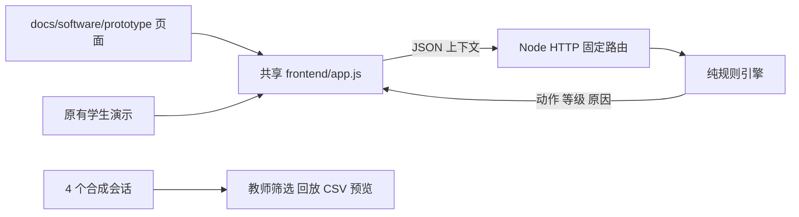
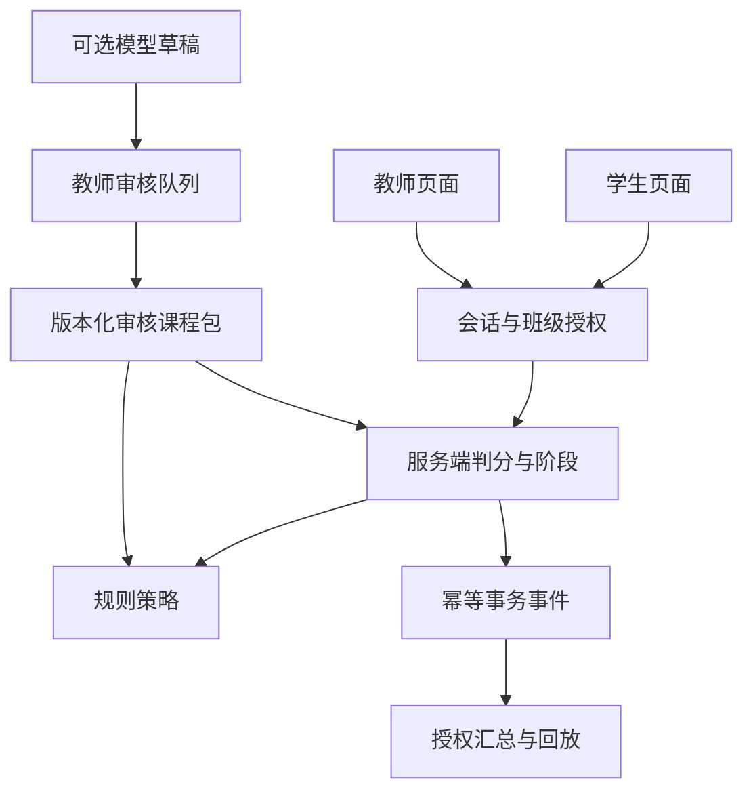

# 技术方案调研与系统架构

版本：0.3；日期：2026-11-04。第三周交付，对照课程 PDF 第 62、66–69 页。结论是当前单题 MVP 约束下的工程判断，没有跨框架性能实验或课堂效果实验。

## 1. 目标与已实现边界

验证“独立尝试 → 可控线索 → 无提示变式验证 → 结果区分”的闭环。第三周提供可运行前端与规则接口；教师界面用 4 个合成会话。正式会话、权限、判分、数据库、模型仍待实现。

基线 Node.js 22+，本轮用 24，CI 覆盖 22/24、Windows/Linux。原生 HTML/CSS/JavaScript 与 Node HTTP 无第三方运行依赖、密钥或 CDN，默认监听本机。数学式采用 MathML，浏览器能力参见 [MDN](https://developer.mozilla.org/en-US/docs/Web/MathML)，兼容证据限实际走查环境。

## 2. 当前结构和请求过程

| 模块 | 已实现职责 | 限制 |
|---|---|---|
| code/frontend/app.js | 作答、分级提示、保护阶段、结果、失败恢复 | 页面状态与判分，刷新清空，不能正式考试 |
| docs/software/prototype | 学生工作台、教师合成预览、设计变量、异常演示 | 教师不读学生本轮状态，不是正式分析服务 |
| code/backend/server.js | 同源页面/API、类型/大小检查、固定白名单 | 无账户、数据库或模型 |
| code/core_engine | 优先级、阈值、预算、冷却 | 无网络/存储，调用方提供状态 |
| tests | 规则、HTTP、合成统计和 CSV 边界 | 不代替教学审核或性能报告 |

前端计算候选错误次数，有效响应后才提交状态；失败保留选择与旧计数。进入验证清空线索并设置保护。服务端目前信任客户端阶段，这是原型限制；后续必须以服务端会话覆盖请求中的阶段字段。

## 3. 八个技术选型维度

### 3.1 编排框架

| 候选 | 适用情况 | 本项目选择 |
|---|---|---|
| 原生模块和显式状态机 | 少量固定阶段、规则需确定可测 | 当前采用，保留纯决策逻辑 |
| LangGraph | 长流程、检查点、人工中断和恢复 | 后续审核工作流候选，当前不加依赖 |
| LangChain Agent / CrewAI / AutoGen | 动态工具或多代理自治 | 当前无必要的自治分工，不增加不确定流程 |

[LangGraph 官方文档](https://docs.langchain.com/oss/javascript/langgraph/overview)说明其有状态编排、持久化和人工介入能力；这是后续考虑理由，项目尚未接入。若审核需跨天恢复或多个外部工具形成长流程，再用相同故障集比较恢复正确性和维护成本。

### 3.2 大模型选型

| 路线 | 价值 | 限制和验证 |
|---|---|---|
| 固定模板与规则 | 内容可逐项审查，无在线 Token 调用 | 当前采用，不能自由对话 |
| 托管 API，以 DeepSeek 为候选 | 不维护本地推理服务，提供 JSON 输出 | 不外发学生信息，测空响应、截断、越界和延迟 |
| Ollama 加经许可本地模型 | 本地评测与控制数据去向 | 需核查许可、硬件和中文数学效果，无 GPU 实测 |

[DeepSeek JSON Output](https://api-docs.deepseek.com/guides/json_mode/)说明配置及空白内容处理；[Ollama Structured Outputs](https://docs.ollama.com/capabilities/structured-outputs)支持 JSON Schema。结构正确不保证内容正确，因此模型只产生教师审核草稿。

草稿限定为 problemId、level、text、sourceIds，不能改学生身份、答案、阶段或权限。后续冻结 20 道合成题 × 5 级提示的 100 项样本，比较来源有效率、答案泄露、人工接受率、失败率、P95 延迟；实际模型版本和价格在评测前冻结。3 秒失败回退审核模板，在线交互不无限重试。当前无依据评出最优模型。

### 3.3 记忆与上下文

当前页面内存；下一轮单机 PoC 优先调研 SQLite：Session 存阶段与版本，Attempt/Decision 存唯一事件号和顺序，不保存按键或自由草稿。短期只传必要状态，长期按事件回放，不反复发送全部历史给模型。

localStorage 易被客户端改写；JSON 文件不便保证原子写入与去重；SQLite 的关系事务适合单机验证；PostgreSQL 可用于未来集中服务，增加部署维护。[SQLite 官方适用场景](https://www.sqlite.org/whentouse.html)区分本地与集中式数据库。选择是约束下推断，不是容量实验。驱动、锁等待、版本兼容在里程碑验证后锁定。

NFR-6 的 30 天保存建议待教师确认；过期删除与导出评估完成前不接真实记录。当前无数据库，候选不等于采用。

### 3.4 工具调用与集成

当前只有 POST /api/decision/evaluate，类型、范围和 16 KiB 限制见[接口说明](接口说明.md)。后续白名单为读取课程包、判分、写事件、读取授权汇总，各自有 Schema、错误码、超时及权限上下文。

OpenAPI 可描述 HTTP 契约；MCP 等到需要跨工具客户端复用时再评估，当前单体不必增加第二套协议。写操作先用 eventId 唯一键实现幂等，再允许有限重试。模型没有 SQL、Shell、任意 URL 权限；保存失败不能返回成功。

### 3.5 检索增强 RAG

当前单概念按 problemId/knowledgePointId/level 选固定审核模板，不需向量数据库。教材扩大后先建立元数据/关键词基线，再比较向量或混合检索；没有语料标注不宣称提升准确性。

按知识点、定义、条件、例题、来源切分，保留页码、版本、审核状态。标答与验证题不能进入学生可检索集合。以至少 30 条教师确认查询比较 Recall@3、来源命中及答案泄露；基础召回不足再研究重排，未命中退回模板或说明暂无线索。

### 3.6 部署与运行时

单进程同源 HTTP，网络异步处理、规则同步计算。固定短提示无需 Token 流式，但展示等待并在 3 秒超时后恢复操作。固定白名单不开放整个 docs 目录。

当前不加 Docker/Kubernetes；需统一环境时先验证单容器、持久卷和备份。SQLite 文件不直接跨节点共享，多实例前改共享数据库或重设持久化。当前不执行用户代码；未来引入执行工具须另设沙箱，不在宿主进程直接运行。

### 3.7 成本与性能

当前模型调用为 0，硬件、网络和维护并非零成本。以下均为预算假设，不是实际用量：

| 场景 | 请求 | 输入/输出 Token | 每百万单价 p_in/p_out 的同币种费用 |
|---|---|---|---|
| 30 人，每人每课 10 次，每次输入 800/输出 200 | 300 | 240,000 / 60,000 | 0.24×p_in + 0.06×p_out |
| 离线 100 项提示样本，同长度假设 | 100 | 80,000 / 20,000 | 0.08×p_in + 0.02×p_out |

价格按供应商实际计费核查，不虚构已批准预算；设日调用上限，用尽回退固定模板。只缓存无身份的审核内容版本，不缓存跨学生验证结果。

性能目标沿用 NFR-9/10：规则 P95≤10ms，30 用户接口 P95≤200ms，非预期 5xx<1%。预热后记录样本、环境及 P50/P95/P99；本轮功能测试不证明压测达标。1.2 秒等待是演示条件，不是实测延迟。

### 3.8 安全与数据边界

当前无身份采集，教师会话和 CSV 标 synthetic。后续服务端区分学生、教师、维护者，校验班级授权。保存 phase、预算、序号、规则版本，覆盖客户端状态。

模型草稿须过来源白名单、Schema 和教师审核，提示注入不能改规则。密钥仅在服务端环境，禁止进入页面、日志和导出。按 NFR-5/6 实现最小采集、保存期及删除；这是工程设计，不是法律认证。

## 4. 目标结构与决策记录

ADR-01：原生前端/Node 单体先验证闭环。ADR-02：模型草稿与阶段控制分离。ADR-03：SQLite 是事件 PoC 优先候选，驱动待验证。ADR-04：合成教师预览与真实事件分离。

US-01–07/10 对应学生界面和规则，US-08–09 对应授权分析，FR-1.3/4.2、NFR-4/7 对应恢复。[两周计划](../mgmt/week3_learning_plan.md)列出学习、日期、产物和 Milestone；交互见[原型说明](prototype/README.md)，结果见[交付核验](../mgmt/week3_delivery.md)。

来源访问日期：2026-11-04。课程依据：[IntelligentSWEPractice](https://github.com/bettermorn/IntelligentSWEPractice)。上文官方文档支撑技术能力，取舍属于本项目分析，不是供应商背书。
