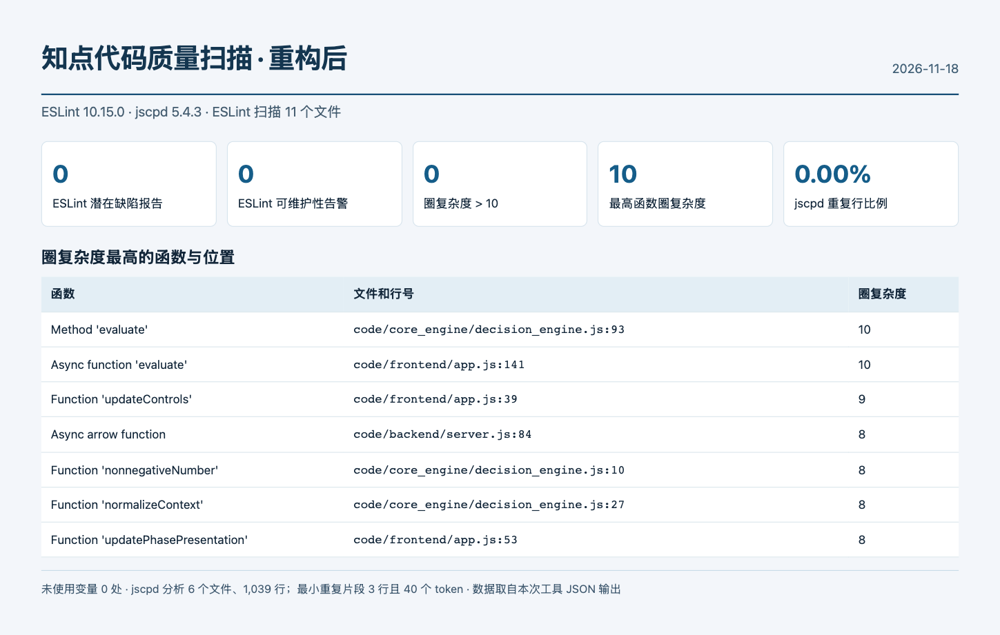
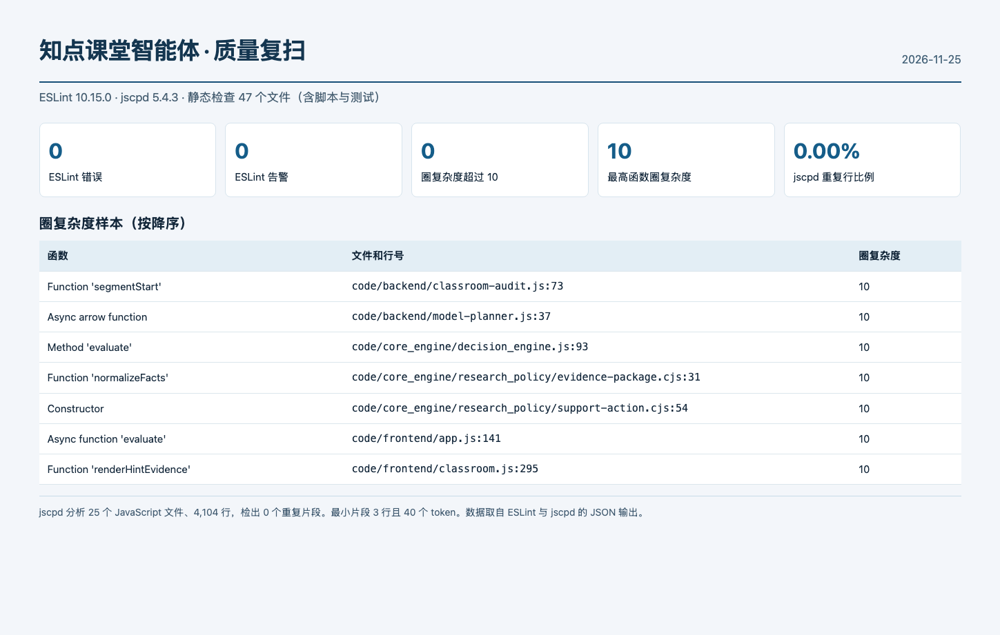

# 代码质量报告

2026 年 11 月 25 日 · 知点翻转课堂

质量检查覆盖课堂业务、智能体、规则引擎、演示页面和运维命令。先对既有代码完成五项重构，再对课堂智能体、机构授权、审计归档和备份恢复执行复扫。 [课程实践要求](https://github.com/bettermorn/IntelligentSWEPractice/blob/main/courseware/pages/part3develop.md#L1302-L1333) · [代码评审记录](code_review.md)

## 五项重构前后

基线为 `f2c7c28`。重构前后使用相同工具、规则、代码范围和 20 项自动用例。ESLint 错误对应本次配置检查的潜在缺陷，告警对应圈复杂度及未使用变量。jscpd 的最小重复片段为 3 行且 40 个 token。

| 指标 | 重构前 | 重构后 |
|---|---:|---:|
| ESLint 潜在缺陷报告 | 0 | 0 |
| ESLint 可维护性告警 | 8 | 0 |
| 圈复杂度超过 10 的函数 | 7 | 0 |
| 最高函数圈复杂度 | 47 | 10 |
| jscpd 重复片段与重复行比例 | 0 个，0.00% | 0 个，0.00% |
| 同口径自动测试 | 20/20 | 20/20 |




| 位置 | 重构决定 | 行为复验 |
|---|---|---|
| 离线体验 | 将路由、页面显示和控件绑定拆开。原渲染函数的圈复杂度从 47 降至入口 1 | 偏好、图形操作、线索、失败恢复、验证、教师回放与模拟发布 |
| 规则界面提示 | 将传输、响应校验和界面展示分别处理。请求函数的圈复杂度从 28 降至 10 | 失败时保留选项，连续错答提示和递进求助 |
| 作答与阶段 | 将阶段显示、练习完成和验证结果分别处理。控件与作答函数的圈复杂度分别从 16、13 降至 9、8 | 进入验证时清空线索，首次通过和重试结果分别显示 |
| HTTP 服务 | 将路由、文件读取、请求体解析和决策返回分开。路由回调的圈复杂度从 12 降至 8 | 方法、媒体类型、多字节长度上限和故障返回 |
| 决策引擎 | 集中校验输入，优先落实暂停、冷却和保护条件。决策函数的圈复杂度从 13 降至 10 | 连续错答、主动求助、预算及保护阶段 |

## 课堂智能体版本复扫



| 检查 | 结果 |
|---|---|
| 静态分析 | ESLint 10.15.0 检查 47 个文件，0 错误、0 告警。最高圈复杂度 10 |
| 重复检查 | jscpd 5.4.3 分析 25 个运行脚本、4,104 行，0 个重复片段，重复行比例 0.00% |
| 自动测试 | 99 项单元及接口测试、2 项 HTTPS 系统测试通过。Ubuntu 安装测试通过 |
| 覆盖率 | Node 单元及接口测试载入的模块合计行覆盖率 94.42%、分支 90.09%。智能体编排行 97.83%、分支 93.68% |
| 浏览器 | Chrome 验证演示课堂和受保护课堂的发布、学生验证、教师回放、失联重试与角色隔离。补验窄屏导出和缺少可信时间的旧记录回放 |
| 依赖审计 | 本轮 npm 审计报告 0 项已知漏洞 |

接口测试覆盖幂等重传、迟到线索拒绝、授权导出、客户端断线和重启恢复。智能体测试验证课包、图谱、会话记忆、模型超时及选材回退。HTTPS 系统测试覆盖清理、轮转、启动检查点及审计容量不足。Ubuntu 安装测试通过参考 systemd 单元启动服务，核对 `401` 响应编号与签名审计记录。 [HTTPS 系统测试](../../tests/system/protected-launch.test.js) · [Linux 安装测试](../../tests/system/linux-service.sh) · [安全与部署](security.md)

## 决策接口性能

参考测量使用提交 `2fbc186`、Ubuntu 24.04、Linux 7.0.0-1020-azure x64 和 Node.js 22.23.5。基准进程的 CPU 亲和性和配额均为 4 核，内存上限为 8 GiB，交换空间为 0。纯规则和 HTTP 串行场景各预热 100 次，再记录 1,000 次。并发场景由 30 个虚拟学生每 5 秒各提交一次，共 120 轮。服务与负载发生器在同一 Node.js 进程运行，HTTP 请求走回环演示接口，使用内置决策。 [运行记录](https://github.com/LJHSTO/edu-promaic/actions/runs/45729578402) · [原始样本（JSON gzip）](media/decision-benchmark-linux.json.gz)

| 环境 | 场景 | 样本数 | P50（ms） | P95（ms） | P99（ms） | 失败数 |
|---|---|---:|---:|---:|---:|---:|
| Linux 参考环境 | 纯规则决策 | 1,000 | 0.000962 | 0.001012 | 0.001383 | 0 |
| Linux 参考环境 | HTTP 串行 | 1,000 | 0.568 | 0.852 | 1.063 | 0 |
| Linux 参考环境 | HTTP 并发 | 3,600 | 12.547 | 20.332 | 23.686 | 0 |
| Apple M5 | 纯规则决策 | 1,000 | 0.000250 | 0.000917 | 0.003958 | 0 |
| Apple M5 | HTTP 串行 | 1,000 | 0.082 | 0.148 | 0.224 | 0 |
| Apple M5 | HTTP 并发 | 3,600 | 7.893 | 9.964 | 12.550 | 0 |

Linux 纯规则 P95 低于 10 ms，HTTP 并发 P95 低于 200 ms，非预期 5xx 为 0/3,600。表中另保留 `d428f37` 在 Apple M5、10 逻辑核、16 GiB、Darwin 25.6.0 和 Node.js 26.13.0 上的结果。分位数按最近秩计算，HTTP 延迟统计采用成功响应。机构 HTTPS 和外部模型的性能随部署环境测量。 [性能需求](../requirements/nonfunctional_spec.md)

在本机运行 `node scripts/benchmark-classroom.js` 可生成逐请求样本、状态码和发起时间。参考工作流先设置并核验进程资源，再按样本数量、响应结果和延迟判定是否达标。 [基准工作流](../../.github/workflows/decision-benchmark.yml) · [测量脚本](../../scripts/benchmark-classroom.js)

## 复验

安装锁定依赖并执行以下检查。GitHub Actions 在 Linux 和 Windows 上运行 Node.js 22 和 24 的矩阵。Linux 任务运行 HTTPS 系统测试，Node.js 22 任务同时安装并启动参考服务单元。

```bash
npm ci --ignore-scripts
npm run check
npm run lint
npm test
npm run test:protected
npm run quality:duplicates -- --threshold 0
npm audit --audit-level=high
```

如需复现 Node.js 覆盖率，运行 `node --test --experimental-test-coverage tests/unit/*.test.js tests/integration/*.test.js`。浏览器流程见运行说明。 [启动与流程](../../README.md#试一遍学习流程)
