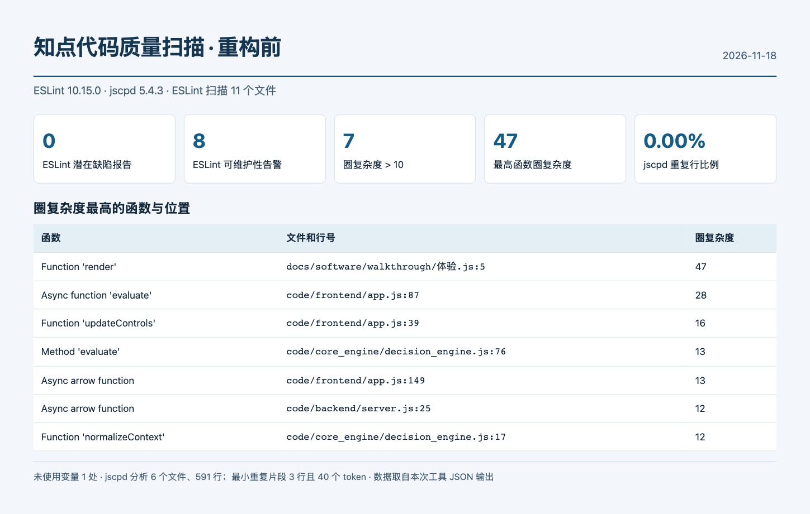

# 代码质量报告

2026 年 11 月 25 日 · 知点翻转课堂

质量检查覆盖课堂业务、智能体、规则引擎和演示页面。先对既有代码完成五项重构，再对接入课包检索、会话保护和机构授权后的版本执行复扫。 [课程实践要求](https://github.com/bettermorn/IntelligentSWEPractice/blob/main/courseware/pages/part3develop.md#L1302-L1333) · [代码评审记录](code_review.md)

## 五项重构前后

基线为 `f2c7c28`。重构前后使用相同工具、规则、代码范围和 20 项自动用例。ESLint 错误对应本次配置检查的潜在缺陷，告警对应圈复杂度及未使用变量。jscpd 的最小重复片段为 3 行且 40 个 token。

| 指标 | 重构前 | 重构后 |
|---|---:|---:|
| ESLint 潜在缺陷报告 | 0 | 0 |
| ESLint 可维护性告警 | 8 | 0 |
| 圈复杂度超过 10 的函数 | 7 | 0 |
| 最高函数圈复杂度 | 47 | 10 |
| jscpd 重复片段与重复行比例 | 0 个，0.00% | 0 个，0.00% |
| 同口径自动测试 | 20/20 | 20/20 |




| 位置 | 重构决定 | 行为复验 |
|---|---|---|
| 离线体验 | 将路由、页面显示和控件绑定拆开。原渲染函数的圈复杂度从 47 降至入口 1 | 偏好、图形操作、线索、失败恢复、验证、教师回放与模拟发布 |
| 规则界面提示 | 将传输、响应校验和界面展示分别处理。请求函数的圈复杂度从 28 降至 10 | 失败时保留选项，连续错答提示和递进求助 |
| 作答与阶段 | 将阶段显示、练习完成和验证结果分别处理。控件与作答函数的圈复杂度分别从 16、13 降至 9、8 | 进入验证时清空线索，首次通过和重试结果分别显示 |
| HTTP 服务 | 将路由、文件读取、请求体解析和决策返回分开。路由回调的圈复杂度从 12 降至 8 | 方法、媒体类型、多字节长度上限和故障返回 |
| 决策引擎 | 集中校验输入，优先落实暂停、冷却和保护条件。决策函数的圈复杂度从 13 降至 10 | 连续错答、主动求助、预算及保护阶段 |

## 课堂智能体版本复扫


| 检查 | 结果 |
|---|---|
| 静态分析 | ESLint 10.15.0 检查 35 个文件，0 错误、0 告警。业务脚本最高圈复杂度 10 |
| 重复检查 | jscpd 5.4.3 分析 23 个运行脚本、3,443 行，0 个重复片段，重复行比例 0.00% |
| 自动测试 | 66 项通过，包括 46 项单元测试及 20 项接口测试 |
| 覆盖率 | Node 测试载入的模块合计行覆盖率 93.68%、分支 91.52%。智能体编排行 95.60%、分支 90.32% |
| 浏览器 | Chrome 演示课堂 11 个检查点及 HTTPS 课堂 5 个检查点通过。验证从教师发布到学生验证和教师回放，包含失联重试、班级角色和小屏操作 |
| 依赖审计 | 本轮 npm 审计报告 0 项已知漏洞 |

接口测试覆盖幂等重传、迟到线索拒绝、发布和会话重启恢复。智能体测试覆盖课程引用、图谱补查、工具范围和模型选材回退。授权测试用合成身份验证跨班级访问、会话所有权、加密存储和审计角色。模型接口使用模拟响应验证，机构接入时再验证实际服务。 [架构](architecture.md) · [安全与部署](security.md)

## 复验

安装锁定依赖并执行以下检查。GitHub Actions 在 Linux 和 Windows 上运行 Node.js 22 和 24 的矩阵。

```bash
npm ci --ignore-scripts
npm run check
npm run lint
npm test
npm run quality:duplicates -- --threshold 0
npm audit --audit-level=high
```

如需复现 Node.js 覆盖率，运行 `node --test --experimental-test-coverage tests/unit/*.test.js tests/integration/*.test.js`。浏览器流程见运行说明。 [启动与流程](../../README.md#试一遍学习流程)
