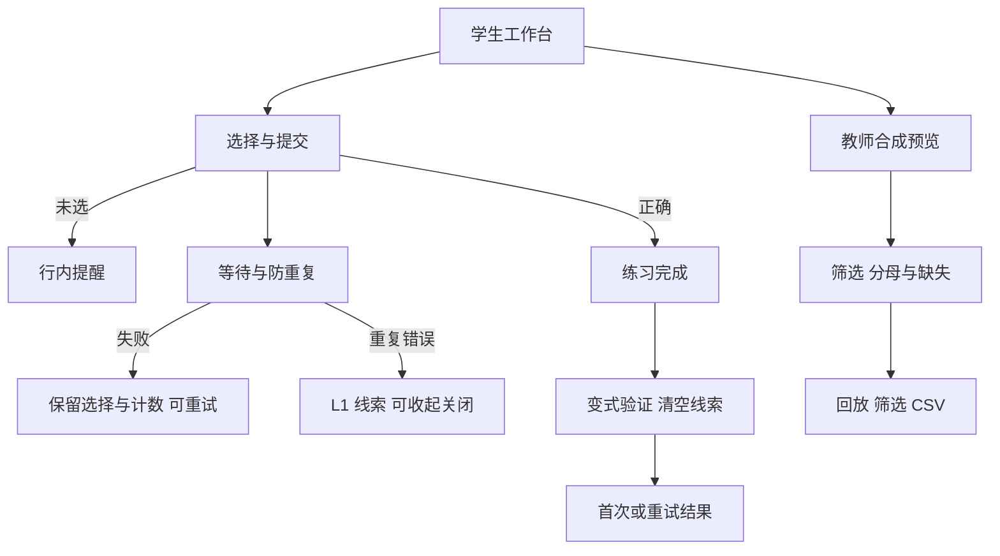

# 规则交互原型

从一道极限题出发，体验分级线索、独立检查和教师记录回放。完整工作台体验见[交互原型](../walkthrough/index.html)。

## 1. 运行与文件

根目录执行 `npm start`，访问 [http://localhost:3000/prototype/](http://localhost:3000/prototype/)。无额外依赖、密钥和 CDN；原有 / 演示继续可用。不能双击 HTML：学生流程需要同源规则 API。

- index.html：真实交互页面和语义结构。
- prototype.css：设计变量、响应式与焦点。
- prototype.js：视图切换、重置、筛选回放、CSV。
- teacher-preview.js：4 个合成会话和纯统计函数。
- code/frontend/app.js：两个入口共享学生流程，不复制规则。

教师预览使用四个固定示例会话，供筛选、回放和导出体验。

## 2. 信息架构与流程

学生：看清目标 → 独立作答 → 按需看线索 → 无提示变式题 → 区分结果。教师：理解样本 → 筛选 → 回放 → 导出。对应[US-01–10](../../requirements/user_stories.md)。

顶部品牌和原型标识，左侧导航与学习路线，中部题目和结果，右侧线索与来源。移动端上下布局。教师视图沿用视觉系统，指标随筛选变化。

## 3. 三层设计与 CRAP

界面：题目主卡、线索侧卡、路线、反馈、来源折叠、教师回放。视觉：主色 #11645d、正文 #172d35、灰绿背景、16px 正文、9/16px 圆角、明显焦点。体验：等待防重、失败恢复、提示可控、验证保护、统计分母、取消重置。

| 原则 | 原界面问题 | 本轮处理 |
|---|---|---|
| 对比 | 练习/帮助/结果优先级近似 | 主题目卡、淡色线索卡、阶段徽章 |
| 重复 | 缺页面级设计变量 | 统一颜色、圆角、卡片和按钮 |
| 对齐 | 缺导航及任务路线 | 内容网格与一致左对齐，窄屏单列 |
| 亲密性 | 线索和来源未成组 | 线索/控制/来源同卡，结果紧随题目 |

## 4. 可复现演示

1. 未选提交；选 A 连错两次得到 L1。
2. 求助递进、收起展开、关闭恢复、展开来源。
3. 选 B 完成后进入验证，旧线索清空、求助禁用；错选 A 再选 B，查看重试结果。
4. 重开先取消再确认；评审设置选失败/超时，错答后正常重试，不提前计为两次错误。
5. 教师默认 4 会话、2/3 首次通过、1 个未开始；筛选重试回放，导出合成 CSV。

评审设置可切换等待、失败和超时状态，用于检查恢复操作。正常模式访问规则 API。界面覆盖未选、等待、成功、错误、关闭、收起、独立检查、重试、结果和取消重置；教师视图支持筛选、空记录、回放和导出反馈。

交互检查覆盖状态反馈、帮助控制、来源展示与错误恢复，见[迭代记录](../../mgmt/week3_delivery.md)。
