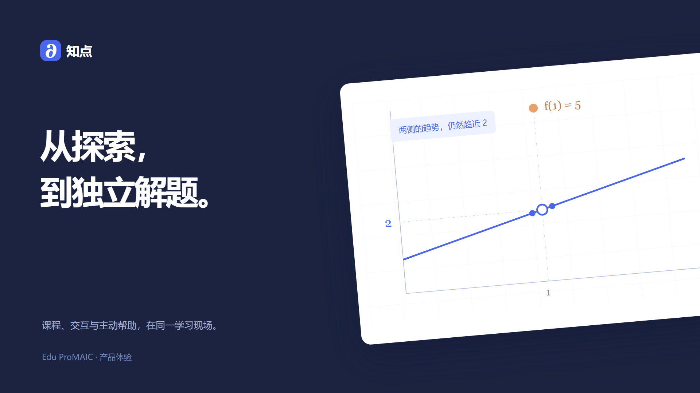

# 知点产品设计

知点把课程内容、交互活动和主动帮助放在同一个学习现场。学生保留探索的节奏，教师能够看到每一步学习发生了什么。

[观看体验视频](media/原型完整体验.mp4) · [交互原型](walkthrough/index.html) · [技术架构](architecture.md)

## 一次完整学习

进入“函数值与极限”课程，先阅读概念，再移动图形中的单点、比较附近数值。作答遇到困难时，助手询问是否需要线索。学生可以接受，也可以继续自己尝试；提示附带可展开的课程来源。

完成当前活动后，学生进入一道同概念新题，独立判断。学习回顾把辅助完成与独立作答分开呈现。教师沿会话过程找到共性问题，预览课程调整并发布新版本。

## 工作台

| 区域 | 内容 |
|---|---|
| 课程导航 | 课程、活动、学习回顾与教师入口 |
| 活动区域 | 概念讲解、可操作图形、题目和即时反馈 |
| 帮助面板 | 提示、课程出处、接受与暂缓控制 |
| 教师工作台 | 学习概览、会话筛选、过程回放和课程发布 |

## 帮助方式由学生选择

判断依据、介入时机、支持起点、显示位置、控制方式和帮助后的继续方式共同决定一次帮助如何发生。偏好随时可改；当前任务的操作和答案在切换帮助时保留。

## 交互与视觉

界面使用墨蓝、白色和蓝色操作反馈，图形中的关键单点用橙色区分。标题、正文、公式和辅助说明有稳定的字号层级，导航与操作位置保持一致。

等待显示当前进度，结果用文字与图标表达。来源可以展开核对；失败后提供重试；发布课程前先预览并确认。主要操作支持键盘，窄屏下工作台按任务顺序排布。

## 扩展课程

微积分是当前的体验内容。学科包包含知识、活动、题目和工具，后续可接入物理仿真、编程练习和语言学习，继续使用相同的学习流程。
