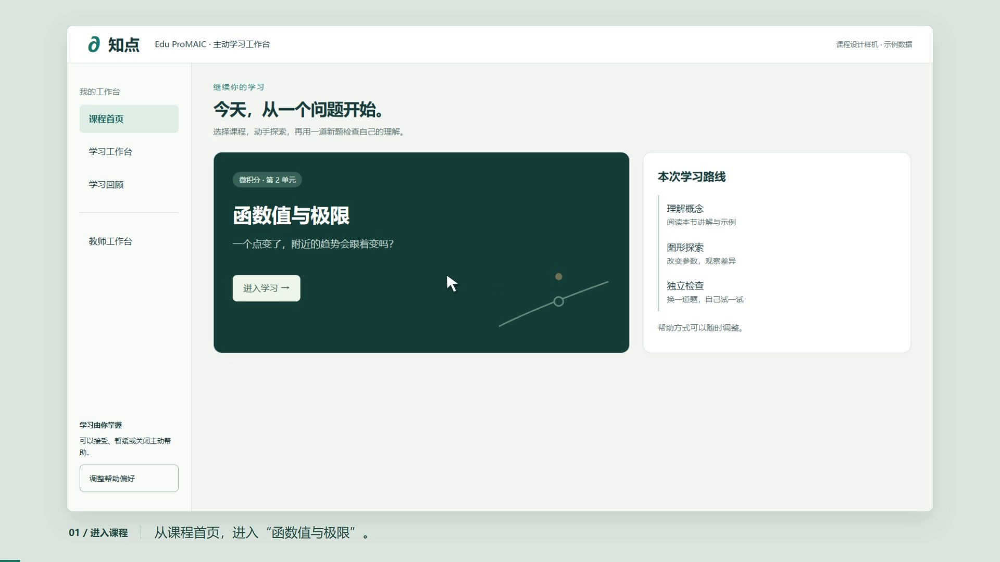

# 原型设计与课堂展示

2026-11-04 · Edu ProMAIC / 知点

[观看完整体验视频](media/原型完整体验.mp4) · [打开可交互样机](walkthrough/index.html) · [六层技术架构](architecture.md)

## 3 分钟原型展示

播放 2 分 28 秒视频，随后用约 32 秒补充设计方法。视频从鼠标点击课程开始，按一次任务连续展开：进入课程 → 设置帮助偏好 → 阅读概念 → 图形探索 → 接受或暂缓帮助 → 核对课程来源 → 改变参数 → 独立新题 → 学习回顾 → 教师筛选与回放 → 预览并确认课程发布。

视频中的界面与可交互样机一致，适合放在仓库作为设计说明。下载仓库后可以直接打开 walkthrough/index.html；现有连接规则 API 的原型仍从 `npm start` 后的 `/prototype/` 进入。新版样机演示目标交互，数据与 RAG 答复使用固定示例。

**播放后这样介绍：**我们的原型把课程、操作和帮助放在同一个任务里。界面上，导航、活动和助手各有固定位置；视觉上，统一颜色、字号和组件；体验上，学生能暂缓帮助、核对出处、在失败后继续，并用新题独立检查。教师再沿过程调整课程。当前用微积分展示，未来通过学科包接入其他课程。

## 界面、视觉、体验三层

| 层次 | 设计决定 | 画面中的具体表现 |
|---|---|---|
| 界面 | 课程首页、学习、回顾、教师工作台；任务内切换讲解、探索和检查 | 导航位置稳定，主区域显示当前活动，助手在任务旁 |
| 视觉 | 青绿主色、琥珀提示色、统一字号、间距和圆角 | 操作按钮清楚，次要说明退到辅助文字，重点由对比和分组表达 |
| 体验 | 学生控制、来源核对、状态反馈、错误恢复 | 先问是否需要、可暂缓、加载状态、失败保留选择、独立检查隐藏提示 |

CRAP 原则对应：用主次按钮和活动卡形成对比；组件反复使用同一视觉规则；标题、正文与操作左对齐；提示、来源和控制归在同一组。

## 图片要求逐项落点

| 检查项 | 样机与目标方案 |
|---|---|
| 状态可见、等待可感知 | 当前学习阶段、材料查找状态、提交结果和课程发布反馈 |
| 贴近真实、识别优先 | “给我线索”“先让我试试”等学生语言，选项和课程路线可见 |
| 用户可控 | 帮助暂缓、取消等待、返回探索、偏好取消与保存 |
| 一致性、极简 | 学生和教师共用导航、卡片、按钮及语义色；不放实现术语 |
| 防错、错误恢复 | 未选时提醒；发布前确认；“换个解释”演示失联，重试恢复且保留图形 |
| 高效 | 原生按钮和选项键盘可操作，焦点可见；对话型输入组件实施时采用 Enter 发送 |
| 能力说明 | 顶部标识设计样机与示例数据；独立检查明确暂不提供线索 |
| 来源可追溯 | 提示展开到课程版本、章节与段落 |
| 风险分级、拦截可理解 | 学习探索可自由试；独立检查说明禁用提示原因；课程发布由教师确认 |
| 隐私透明 | 样机不采集身份或上传文件；正式方案使用课程授权和必要上下文 |
| 无障碍、响应式 | 语义按钮、键盘焦点、弹窗 Escape/焦点循环；结果有文字与符号；320px 单列 |

自评基于功能检查与页面走查；课堂教师评审和真实学生试用在后续收集。反馈记录采用“具体任务 → 卡住的位置 → 调整 → 再试”的顺序。

## 视频声音与节奏

画面以操作和反馈确定节奏，保留阅读与思考时间，不让所有动作机械卡在鼓点。进入与探索使用 Close Up；独立检查过渡到 Digital Clouds 并降低音乐；教师回看回到有节奏的配乐。点击、确认和完成声音对应实际按钮事件，错误状态不使用夸张警报。无全程 AI 配音，底部短句交代任务。

参考 [Linear Learn 的完整工作流演示](https://linear.app/learn/building-with-your-users)以及 [Notion 产品教学](https://www.notion.com/help/guides/category/ai)中的“具体操作—结果—下一步”组织方式。参考素材仅用于分析，不进入成片。音乐与编辑方式见[视频源文件说明](video/README.md)。
